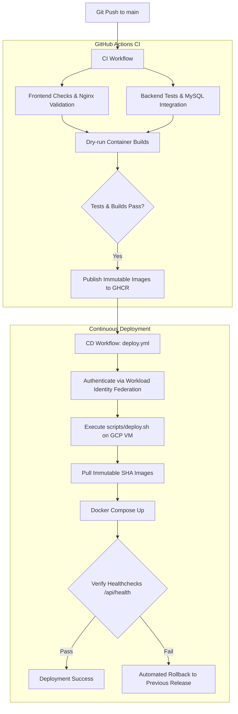

# Continuous Integration & Continuous Deployment (CI/CD)

The Campus Lost & Found Portal uses **GitHub Actions** for automated testing, container image publishing to **GitHub Container Registry (GHCR)**, and continuous deployment to the **Google Cloud Compute Engine VM**.

---

## 1. Pipeline Overview



---

## 2. Workflows Reference

### 2.1 Continuous Integration (`.github/workflows/ci.yml`)
* **Triggers**:
  * Any pull request targeting `main`.
  * Direct push to `main`.
* **Jobs**:
  1. `frontend-ci`:
     * Validates JavaScript syntax (`node --check`).
     * Verifies Nginx configuration syntax with Alpine image (`nginx -t`).
     * Tests building frontend Docker image with layer caching.
  2. `backend-ci`:
     * Starts an official `mysql:8.4` service container.
     * Installs dependencies on Python 3.12.
     * Executes `flake8` for code quality checks.
     * Runs 30+ pytest unit tests with SQLite and test coverage report.
     * Executes integration tests against the live MySQL service container.
     * Builds backend Docker image and verifies `/api/health` passes.
  3. `publish-images` *(Only on pushes to `main`)*:
     * Builds and pushes immutable release tags (`ghcr.io/sushantapatil2006/lostandfound-frontend:<COMMIT_SHA>` and `lostandfound-backend:<COMMIT_SHA>`).
     * Also updates `:latest` tag for convenience.

### 2.2 Continuous Deployment (`.github/workflows/deploy.yml`)
* **Trigger**: Triggered automatically when `CI and Container Publishing` completes successfully on `main` (or manually via `workflow_dispatch`).
* **Environment**: `production`.
* **Concurrency**: Restricted to 1 active deployment (`production-deployment`).
* **Steps**:
  1. Identifies the Git commit SHA from the triggering event.
  2. Authenticates to Google Cloud using short-lived OIDC tokens via **Workload Identity Federation**.
  3. Connects to the VM through the secure **IAP tunnel** (or SSH).
  4. Dispatches `./scripts/deploy.sh <COMMIT_SHA>`.
  5. Verifies container health check endpoints.
  6. Automatically executes rollback if the health checks fail.

---

## 3. GitHub Configuration Checklist

Configure these under **Repository Settings -> Secrets and variables -> Actions**:

### Variables (`vars`)
| Name | Required | Example | Purpose |
| :--- | :--- | :--- | :--- |
| `GCP_PROJECT_ID` | Yes | `campus-laf-prod` | Google Cloud project identifier. |
| `GCP_ZONE` | Yes | `us-central1-a` | Compute Engine instance zone. |
| `GCP_VM_NAME` | Yes | `lostandfound-prod` | Compute Engine instance name. |
| `GCP_WORKLOAD_IDENTITY_PROVIDER` | Yes | `projects/123/locations/global/workloadIdentityPools/...` | Provider path for OIDC token exchange. |
| `GCP_DEPLOY_SERVICE_ACCOUNT` | Yes | `github-deployer@proj.iam.gserviceaccount.com` | Dedicated deployment service account. |
| `DEPLOY_DOMAIN` | Optional | `lostandfound.campus.edu` | Used for HTTPS domain routing in Caddy. |

### Secrets (`secrets`)
* Application secrets (`SECRET_KEY`, `MYSQL_PASSWORD`) reside **strictly on the VM** in `/opt/lostandfound/.env`. They are never stored in GitHub Actions secrets or repository files.
* If using direct SSH instead of Workload Identity Federation / IAP:
  * `SSH_PRIVATE_KEY`: Private key for the deployment user on the VM.
  * `SSH_KNOWN_HOSTS`: Host key fingerprint for the VM.

---

## 4. Troubleshooting CI/CD

### Pipeline Fails in `backend-ci`
* Check if a test failed: View the pytest output step.
* Check if a lint check failed: `flake8` prints undefined variables or syntax errors.

### Pipeline Fails in `publish-images`
* Ensure GitHub repository settings permit GitHub Actions to write packages:
  * Go to **Settings -> Actions -> General -> Workflow permissions**.
  * Select **Read and write permissions**.

### Deployment Fails on VM
* Review GitHub Actions logs for `deploy.yml`.
* SSH into the VM to inspect logs directly:
  ```bash
  cd /opt/lostandfound
  docker compose -f docker-compose.prod.yml logs --tail 100
  ```
* Test health endpoint on the VM:
  ```bash
  curl -i http://127.0.0.1:8080/api/health
  curl -i http://127.0.0.1:8080/healthz
  ```
